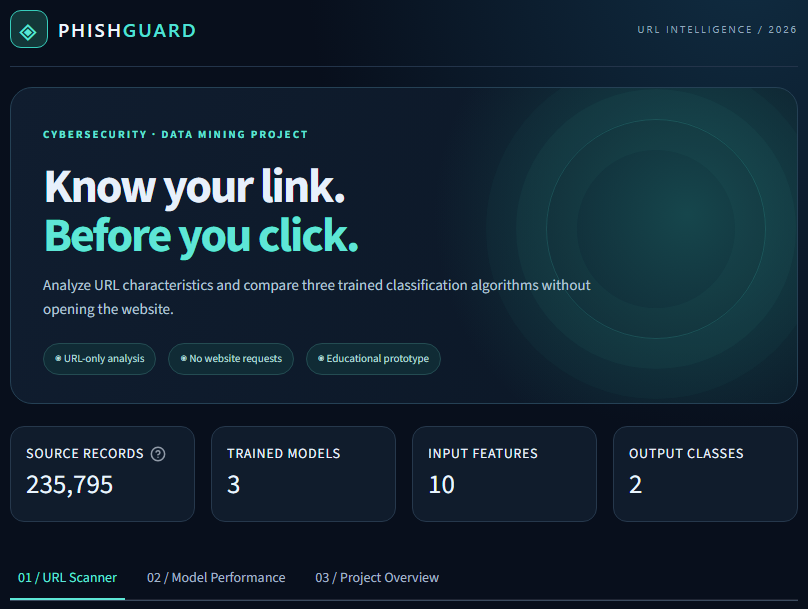
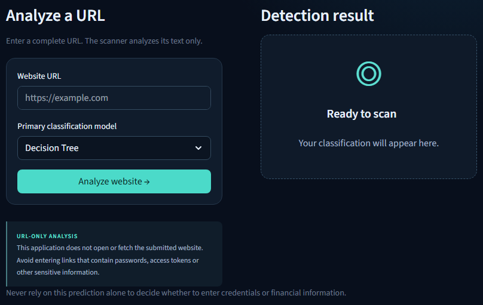
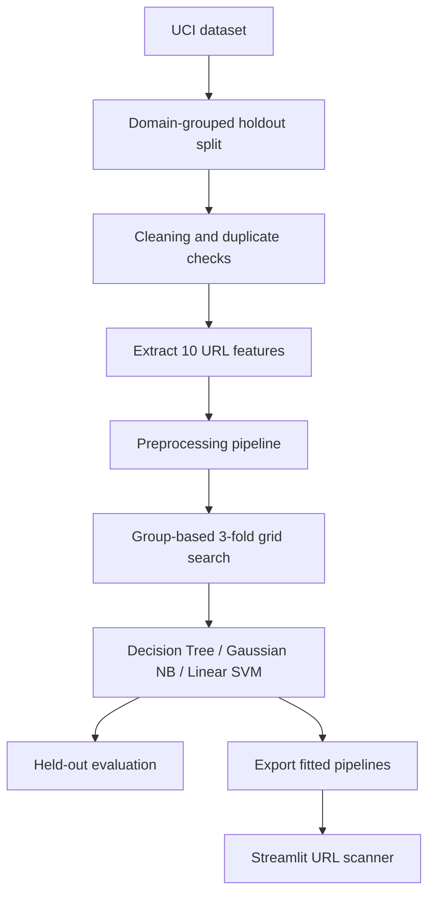
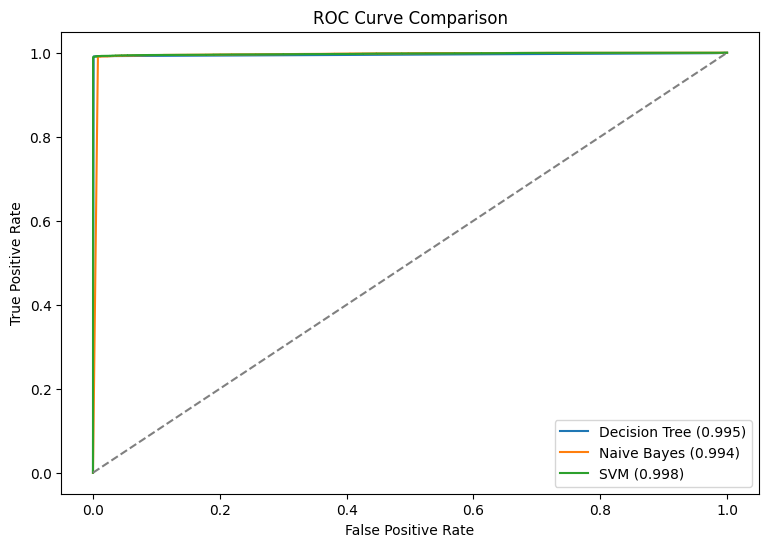
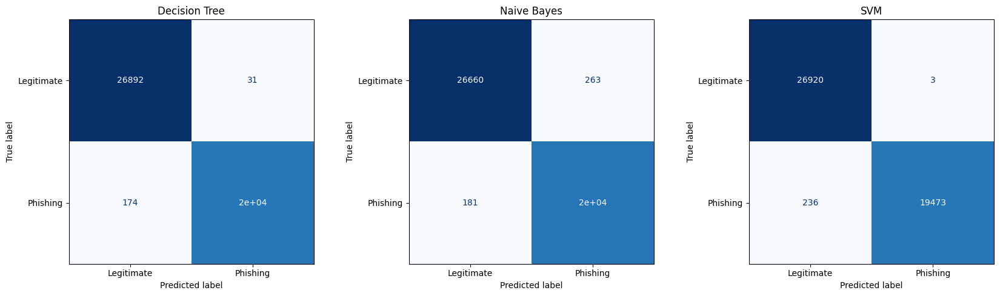
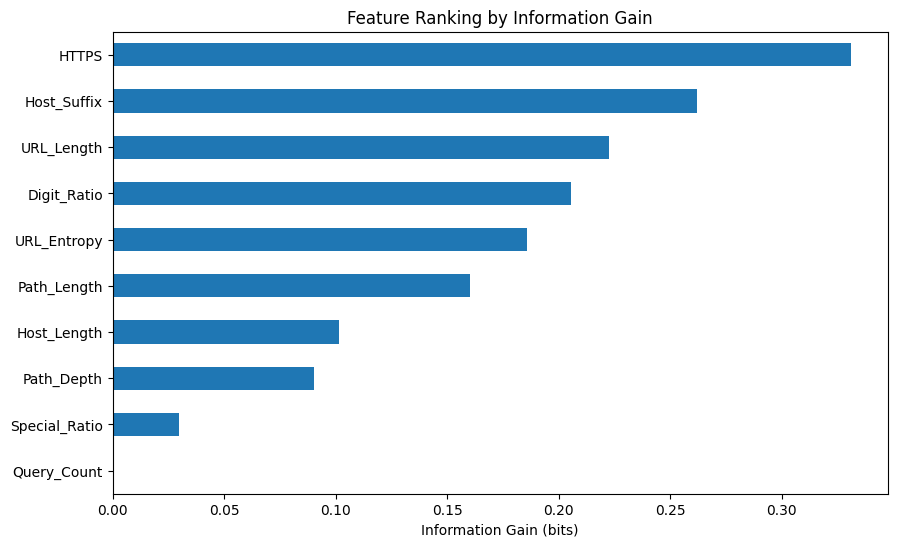

<div align="center">

# PhishGuard

**Phishing Website Detection Using Data Mining**

An end-to-end data mining project for phishing detection, combining exploratory analysis, feature engineering, supervised classification and an interactive Streamlit application.


[Explore the notebook](notebooks/PhishGuard_Data_Mining.ipynb) · [Model results](#model-performance) · [Run locally](#run-locally)

[](https://phishguard-ahmed.streamlit.app/)

[Open PhishGuard in your browser](https://phishguard-ahmed.streamlit.app/) · No installation required

</div>

---

## Overview

Phishing websites can imitate legitimate services and trick users into revealing sensitive information. PhishGuard explores how URL structure can help distinguish phishing from legitimate websites, without visiting the submitted website.

The project combines exploratory data analysis, feature engineering, leakage-aware evaluation, and an interactive Streamlit interface. It is an educational prototype, not a production security service.

| Source records | Clean records | URL features | Classifiers |
| :---: | :---: | :---: | :---: |
| 235,795 | 235,370 | 10 | 3 |

## Application

- **URL Scanner:** predicts phishing or legitimate from the URL text and displays the extracted features.
- **Model comparison:** compares Decision Tree, Gaussian Naive Bayes and Linear SVM predictions for the same input.
- **Performance dashboard:** displays held-out accuracy, precision, recall, F1-score and ROC-AUC.
- **Project overview:** explains the data source, feature pipeline, training and limitations.

No HTTP requests are sent to the submitted website. Do not enter private URLs, tokens or credentials into the public demo.

### Live application preview

[](https://phishguard-ahmed.streamlit.app/)

### Interactive URL scanner



Try the [live demo](https://phishguard-ahmed.streamlit.app/) with `https://example.com` to see a classification and compare the three models. The screenshots show the deployed application, not a simulated interface.

## Dataset

[PhiUSIIL Phishing URL Dataset (2024)](https://archive.ics.uci.edu/dataset/967/phiusiil+phishing+url+dataset) — UCI Machine Learning Repository, dataset ID 967.

| Item | Value |
| --- | ---: |
| Original samples | 235,795 |
| Original input features | 54 |
| Legitimate records | 134,850 |
| Phishing records | 100,945 |
| Removed records during cleaning | 425 |
| Final training samples | 188,738 |
| Final held-out test samples | 46,632 |

The dataset is retrieved directly from UCI in the notebook; raw data is not included in this repository. Original labels are mapped to `0 = legitimate`, `1 = phishing` for modeling.

## Methodology



- **Preprocessing:** duplicate removal, missing-value checks, IQR outlier detection, median/mode imputation, log transformation, standardization and one-hot encoding. No SMOTE was used because the training classes were relatively balanced.
- **Feature engineering:** all ten selected features are reproducible directly from URL text.
- **Evaluation:** approximately 80/20 domain-grouped holdout, with three-fold stratified group cross-validation and grid search on the development set. The fitted transformations do not use held-out test statistics.

| URL feature | Description |
| --- | --- |
| URL_Length | Total URL length |
| Host_Length | Hostname length |
| Path_Depth | Number of nonempty path segments |
| Path_Length | Number of path characters |
| Query_Count | Number of query segments |
| URL_Entropy | Shannon character entropy |
| Digit_Ratio | Fraction of digits |
| Special_Ratio | Fraction of non-alphanumeric characters |
| HTTPS | HTTPS scheme indicator |
| Host_Suffix | Last hostname component, or unknown |

## Model performance

Recorded held-out results from the project notebook (46,632 test samples). Values are percentages rounded to two decimal places.

| Model | Accuracy | Precision | Recall | F1-score | ROC-AUC |
| --- | ---: | ---: | ---: | ---: | ---: |
| **Decision Tree** | **99.56%** | 99.84% | **99.12%** | **99.48%** | 99.49% |
| Gaussian Naive Bayes | 99.05% | 98.67% | 99.08% | 98.88% | 99.39% |
| Linear SVM | 99.49% | **99.98%** | 98.80% | 99.39% | **99.76%** |

Decision Tree was selected based on F1-score and recall. It produced 31 false positives and 174 false negatives. Linear SVM achieved the highest ROC-AUC and precision. These are dataset-specific test results, not a guarantee of real-world accuracy.

### ROC curves



### Confusion matrices



### Feature analysis

HTTPS, host suffix, URL length, digit ratio and URL entropy were the five highest-ranked features by individual information gain. This is a univariate association measure, not model-specific feature importance or evidence of causation.



## Project structure

```text
PhishGuard/
├── app.py                         # Streamlit interface
├── features.py                    # Original URL feature functions
├── model_io.py                    # Model bundle loader
├── smoke_test.py                  # Inference and migration test
├── style.css                      # Interface styling
├── .streamlit/config.toml         # Streamlit theme
├── notebooks/
│   └── PhishGuard_Data_Mining.ipynb # Training, evaluation and export
├── assets/                        # Evaluation plots and live app screenshots
├── export_colab.py                # Export helper (run in trained Colab session)
├── model_comparison.csv           # Recorded metrics
├── requirements.txt               # Pinned application dependencies
├── models.pkl                     # Original trained pipelines
├── model_environment.json         # Runtime metadata (on re-export, optional)
└── README.md
```

## Run locally

The fitted model pipelines are included in `models.pkl`; **no training is required** to run the scanner. The published model bundle was migrated to store the fitted pipelines without serialized notebook feature functions, and all three classifiers passed the local inference smoke test on Python 3.11.9 with scikit-learn 1.6.1. URL feature extraction is implemented in `features.py`. Install the pinned dependencies and only load trusted pickle files.

### 1. Create an environment

In the repository directory:

```bash
python -m venv .venv
```

### 2. Install, verify and start

On Windows PowerShell:

```powershell
.\.venv\Scripts\python.exe -m pip install -r requirements.txt
.\.venv\Scripts\python.exe smoke_test.py
.\.venv\Scripts\python.exe -m streamlit run app.py
```

On macOS/Linux:

```bash
.venv/bin/python -m pip install -r requirements.txt
.venv/bin/python smoke_test.py
.venv/bin/python -m streamlit run app.py
```

Open `http://localhost:8501` and try the harmless example `https://example.com`. The result is a model prediction, not a safety verdict.

### Reproduce training (optional)

The notebook contains all training and evaluation steps. To regenerate the model bundle, run it in Colab and use Section 12 (or `export_colab.py`). Replace the deployment files with the newly exported files together; `model_environment.json` will record the runtime for that export.

## Deploy to Streamlit Community Cloud

The public application is hosted at [phishguard-ahmed.streamlit.app](https://phishguard-ahmed.streamlit.app/). To deploy your own copy:

1. Run the local smoke test. Push the repository, including `models.pkl`, `model_comparison.csv` and `requirements.txt`, to GitHub. Do not commit secrets or private URLs.
2. Sign in at [Streamlit Community Cloud](https://share.streamlit.io/) with GitHub.
3. Select **Create app**, the repository, branch `main`, and entry point `app.py`.
4. In **Advanced settings**, choose the Python major/minor version that passed the local smoke test (prefer the original export version).
5. Deploy and verify that the scanner and performance tab work. If you fork this repository, update the demo links to your own application URL.

## Limitations

- URL-only analysis cannot verify website identity, page content, certificate validity or current reputation.
- Dataset collection bias and patterns shared by related domains can influence the results. The split prevents overlap of exact normalized domain strings, not all possible domain relationships.
- HTTPS is not evidence that a website is trustworthy. Predictions may fail on new attack patterns or independent datasets.
- Never use this prototype as the sole basis for entering credentials or financial information.

## Project Report

[📄 View Project Report (PDF)](docs/PhishGuard_Report.pdf)


## Author

**Ahmed Abdelmoula** — Computer Engineering student. Developed as a Data Mining term project (2026).
